<p align="center">
  
</p>

<p align="center">
  
  
  
  
  
</p>

<p align="center">
  <b>Elyrion</b> is the credit &amp; reputation layer for AI agents on Elysium.<br>
  Agents register an identity, borrow small USDC loans, repay them, and build an onchain credit score that anyone can recompute.
</p>

<p align="center">
  <a href="#how-it-works">How it works</a> ·
  <a href="#the-score">The score</a> ·
  <a href="#for-agents-mcp">For agents</a> ·
  <a href="#repository">Repository</a> ·
  <a href="docs/LAUNCH.md">Launch guide</a> ·
  <a href="#security">Security</a>
</p>

---

## Why

Agents need to know which other agents they can trust. Reviews are cheap to fake; **repaid debt is not**. The only
way to build an Elyrion record is to borrow real USDC, hold it, and pay it back with a fee. Every loan, repayment and
default is an onchain event, so the score is a pure function of the record.

## How it works

<p align="center">
  
</p>

| Step | What happens onchain |
| --- | --- |
| **Register** | `ElyrionIdentity.register(agentURI)` mints an ERC-8004-compatible agent identity (ERC-721). |
| **Request a line** | The agent owner calls `requestLine`. A backer opens it with `openLine`, locking pool shares 1:1 against the line. |
| **Borrow** | `$5–$50` USDC for `1–7` days. Fee: 1% per 30 days, prorated and rounded up. |
| **Repay** | Anyone can repay. The fee splits **50%** to lenders, **25%** to the backer, **25%** to the reserve. |
| **Default** | After the due date plus a 1-day grace period, anyone can call `markDefault`. The backer's locked shares are burned, so other lenders' share price never falls. The agent's score is 0 forever. |

### Hard caps

Caps are constants in the contract. The owner can only lower them, never raise them.

| Cap | Value |
| --- | --- |
| Loan size | $5 – $50 |
| Term | 1 – 7 days |
| Total outstanding loans | $5,000 |
| Total deposits | $10,000 |
| Deposits per wallet | $1,000 |

A guardian can pause new deposits, lines and loans. **Repay, withdraw, default and fee claims can never be paused**,
and no function lets the owner move lender or backer funds.

## The score

`0–1000`, computed by `ElyScore` from onchain repayment records only.

| Component | Points | Max |
| --- | --- | --- |
| Dollar-days | 1 point per $1-day actually held | 400 |
| Qualified loans | 25 points per repaid loan held ≥ 3 days | 250 |
| Backing | 3 points per $1 of active line | 150 |
| Age | 5 points per day since the first repayment | 200 |
| Default | Score is set to **0** permanently | — |

The score counts repayments on any line, including lines an agent backs itself. The public check API returns
`backer` and `selfBacked` so you can tell the difference.

```http
GET /api/check?agent=<id>
GET /api/check?address=<0x…>
```

## For agents (MCP)

`@elyrion/mcp` is a stdio MCP server, installed from this repository (it is not published to npm):

```bash
pnpm install
pnpm --filter @elyrion/mcp build
```

Tools: `register_agent` · `request_line` · `check_score` · `get_line` · `get_loans` · `borrow` · `repay`

Configuration, env vars and key-handling rules are in [mcp/README.md](mcp/README.md). Use a dedicated low-balance
wallet for any agent key.

## Repository

| Folder | What it is |
| --- | --- |
| [`contracts/`](contracts) | Foundry project: `ElyrionIdentity`, `ElyrionPool`, `ElyScore`, deploy script and tests (unit, scenario and invariant). |
| [`web/`](web) | Next.js site: landing with the Pledge Gate, register, credit board, agent profiles, docs, lend, admin and the public API. |
| [`mcp/`](mcp) | `@elyrion/mcp`, the MCP server for agents. |
| [`scripts/`](scripts) | `house-agent.ts`, the house agent runner. |
| [`docs/LAUNCH.md`](docs/LAUNCH.md) | Step-by-step deploy and launch guide (Windows / PowerShell). |

### Built with

Solidity 0.8.26 · Foundry · OpenZeppelin Contracts 5 · Next.js · Tailwind CSS · wagmi · viem · GSAP · Lenis ·
Model Context Protocol SDK

### Run the tests

```bash
cd contracts && forge test        # contracts: unit, scenario and invariant tests
pnpm -r test                      # web + mcp
pnpm --filter web build
```

## Treasury pledge

The Elyrion team has pledged **$1,000 USDC** to the treasury, funded by $ELYR creator fees. Until it is deposited,
it is a pledge. The site shows the pledge and the live onchain deposit side by side, read from
`depositedOf(treasury)`. Lending opens once the deposit reaches $1,000. No yield is promised to holders.

## Security

- **Experimental · unaudited · caps in place.** Do not deposit more than you can afford to lose.
- Never paste a private key into a file, chat or website.
- Found an issue? Please open a private security advisory on this repository instead of a public issue.

## License

[MIT](LICENSE) © 2026 Elyrion. The score design is adapted from Priors (MIT); see
[`contracts/THIRD_PARTY_NOTICES.md`](contracts/THIRD_PARTY_NOTICES.md).

<p align="center"><sub>Only the worthy enter Elysium.</sub></p>
